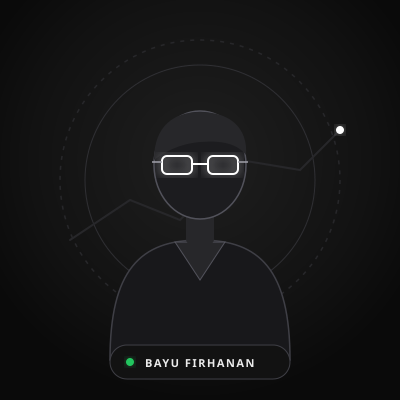

# 🌐 Website Perkenalan Diri - Bayu Firhanan (Dazzle)

Website perkenalan diri dan portofolio profesional dengan estetika **Dark Luxury Tech** yang terinspirasi dari `https://kingfars.my.id/`. Dibuat dengan Tailwind CSS, Font Outfit & Space Mono, Phosphor Icons, dan efek micro-interaction halus.

---

## 👤 Data Diri Terpasang

- **Nama**: Bayu Firhanan / Dazzle
- **Instagram**: @Bayufirhanan (`https://instagram.com/Bayufirhanan`)
- **WhatsApp**: 0813-5268-9234 (`https://wa.me/6281352689234`)
- **Email**: Bayufirhanan@gmail.com
- **Foto Profil**: Menggunakan placeholder avatar tech SVG (`assets/avatar.svg`) dan siap diganti kapan saja.

---

## ✨ Fitur Unggulan

- **Cyber/Luxury Aesthetics**: Background Midnight Navy (`#050a14`), aksen Gold Emas (`#D4AF37`) & Neon Cyan (`#00f2ea`).
- **Interactive Preloader**: Layar pembuka animasi progress bar dengan tulisan *"Memuat Data..."*.
- **Custom Mouse Follower**: Kursor khusus desktop dengan efek membesar saat mengarahkan ke tombol/link.
- **Glassmorphism Design**: Efek kaca blur semi-transparan dengan border subtle bercahaya.
- **Interactive Project Tabs**: Filter proyek berdasarkan kategori (*Semua*, *Web Development*, *UI/UX Design*, *Aplikasi*).
- **Live Counter Animation**: Angka statistik bergerak otomatis saat halaman di-scroll.
- **Accordion FAQ**: Tanya jawab interaktif yang dapat dibuka/tutup dengan transisi halus.
- **One-Click Email Copy**: Salin alamat email dengan satu klik disertai pop-up toast notifikasi.
- **Mobile Responsive**: Tampilan optimal di smartphone, tablet, maupun layar monitor desktop besar.

---

## 📁 Struktur File

```text
website-perkenalan-diri/
├── index.html        # File HTML utama (struktur & konten)
├── css/
│   └── style.css     # Style custom (kursor, glassmorphism, animasi)
├── js/
│   └── main.js       # Logika interaktif (preloader, tabs, counter, FAQ)
├── assets/
│   └── avatar.svg    # Placeholder foto profil beranimasi tech
└── README.md         # Panduan penggunaan & kustomisasi
```

---

## 🚀 Cara Menjalankan Website

1. **Cara Paling Mudah (Offline / Langsung)**:
   - Buka folder `website-perkenalan-diri`.
   - Klik dua kali file `index.html`. Website akan langsung terbuka di browser Anda (Chrome, Edge, Firefox, dll).

2. **Menggunakan Live Server (VS Code / Antigravity)**:
   - Buka folder ini di editor.
   - Klik kanan pada `index.html` dan pilih **Open with Live Server**.

---

## 🎨 Panduan Kustomisasi

Semua teks dan link ada di dalam file `index.html`:

### 1. Mengganti Nama & Logo
Cari teks `ALEX DEV` atau `Alex Pratama` di `index.html` dan ubah sesuai nama Anda.
```html
<a href="#" class="text-2xl font-extrabold tracking-tighter text-white">
    NAMA <span class="text-gold">ANDA</span><span class="text-cyan">.</span>
</a>
```

### 2. Mengganti Foto Profil
1. Masukkan file foto Anda (misalnya `profil.jpg` atau `profil.png`) ke dalam folder `assets/`.
2. Di `index.html`, cari tag ``:
```html
<!-- Ganti dari: -->


<!-- Menjadi: -->

```

### 3. Mengatur Nomor WhatsApp & Tautan Sosial
Cari bagian `#contact` di `index.html`:
- **WhatsApp**: Ganti nomor `6281234567890` dengan nomor WhatsApp aktif Anda (gunakan format internasional diawali kode negara `62` tanpa tanda `+`).
- **Instagram**: Ganti link `https://instagram.com/username_anda`.
- **Email**: Ubah teks email di pemanggilan fungsi `copyEmail('emailanda@gmail.com')`.

---

## 🌐 Cara Upload / Hosting Online (Gratis + Domain .my.id)

Untuk menjadikan website ini online seperti `kingfars.my.id`:

1. **Upload ke Vercel (Paling Direkomendasikan)**:
   - Buat akun gratis di [vercel.com](https://vercel.com).
   - Tarik (*drag & drop*) folder `website-perkenalan-diri` ke dashboard Vercel.
   - Website Anda langsung online dalam hitungan detik dengan URL gratis (misal: `namaanda.vercel.app`).

2. **Menghubungkan ke Domain `.my.id`**:
   - Beli domain `.my.id` di penyedia domain lokal (harganya sangat terjangkau, sekitar Rp 10.000 - Rp 25.000 / tahun).
   - Di pengaturan domain (*DNS Management*), arahkan CNAME ke server Vercel atau GitHub Pages sesuai panduan penyedia domain Anda.
